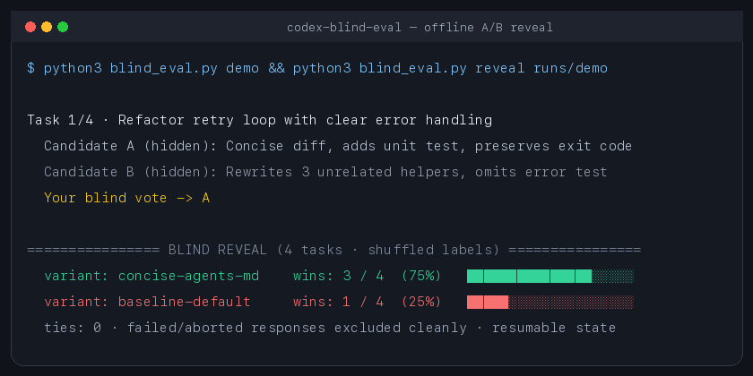

# Codex Blind Eval

[Русский](README.ru.md) · [MIT](LICENSE)

Did a change to your Codex instructions make its answers more useful? Give both configurations the same tasks, compare their answers as A and B, then reveal which configuration wrote each one.

The tool randomizes labels and execution order independently for each task. It saves only complete answers, resumes missing attempts, and keeps ties and skipped pairs separate. You supply the tasks and judge the answers.

## Try it offline

Python 3.11 or newer; no dependencies, Codex account, or network needed for the demo.

~~~sh
mkdir -p runs
python3 blind_eval.py demo runs/demo
~~~

Read **runs/demo/blind.json** in a text editor. Enter **A**, **B**, **tie**, or **skip** for each task in **runs/demo/votes.json**. Reveal the labels:

~~~sh
python3 blind_eval.py reveal runs/demo
~~~

The demo uses fictional answers. The run directory must be new.

## Compare your own instructions

Use a Codex CLI that supports the run flags shown in [blind_eval.py](blind_eval.py). Edit [tasks](examples/tasks.toml) and exactly two [variants](examples/variants.toml). Each variant provides inline AGENTS.md instructions and may specify a model and reasoning effort. To measure an instruction change, keep the other settings fixed and decide what a good answer looks like before judging.

~~~sh
python3 blind_eval.py prepare runs/trial --tasks examples/tasks.toml --variants examples/variants.toml
CODEX_HOME="$PWD/runs/trial/profile" codex login -c 'cli_auth_credentials_store="file"'
python3 blind_eval.py run runs/trial
# Read blind.json and fill in votes.json inside runs/trial.
python3 blind_eval.py reveal runs/trial
~~~

The tool creates a fresh profile without copying credentials, settings, skills, or past sessions. Each attempt uses a temporary task directory, a read-only Codex session, and disabled shell tools, hooks, connectors, and web search. Keep the run directory private: it holds the inputs, label key, answers, and the profile used for sign-in. A live run sends the prompts and instructions to Codex; use inputs you are allowed to send. Use a trusted Codex installation and a controlled account for sensitive evaluations.

This is a small human evaluation, not a statistical ranking. Answers may reveal their style; one pair per task cannot isolate model variation. The tests use a fake CLI to exercise failure and resume without an account. [Attribution](NOTICE.md).

~~~sh
python3 -B -m unittest discover -s tests -v
~~~
