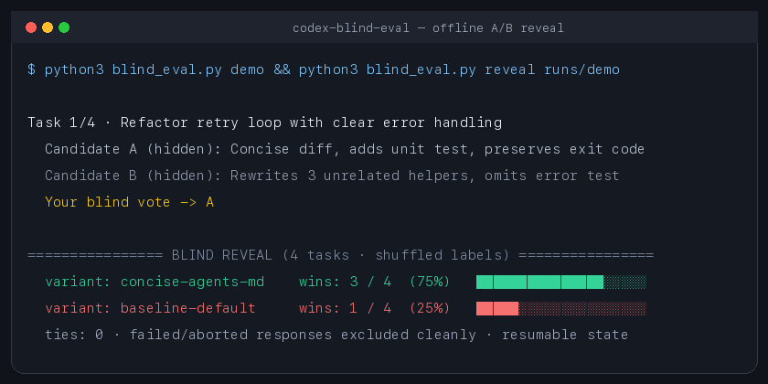

# Codex Blind Eval

[English](README.md) · [MIT](LICENSE)

> **Работает с Codex CLI, Claude Code (`--runner claude`) и любым другим CLI / локальной LLM (`--runner command`).**

Стали ли ответы агента полезнее после правки `AGENTS.md`, `CLAUDE.md` или системного промпта? Дайте двум настройкам одинаковые задания, сравните ответы вслепую под буквами **A** и **B**, а потом раскройте, какая конфигурация дала каждый ответ.

Инструмент перемешивает буквы и порядок запуска отдельно для каждого задания, сохраняет только завершённые ответы, продолжает с пропущенной попытки и отдельно считает ничьи и пропуски.

## Офлайн-демо

Нужен Python 3.11 или новее. Демо работает без зависимостей, аккаунта и сети.

~~~sh
mkdir -p runs
python3 blind_eval.py demo runs/demo
~~~

Откройте **runs/demo/blind.json** в текстовом редакторе. Для каждого задания запишите **A**, **B**, **tie** (ничья) или **skip** (пропуск) в **runs/demo/votes.json**. Затем раскройте буквы:

~~~sh
python3 blind_eval.py reveal runs/demo
~~~

## Сравнить свои инструкции

Отредактируйте [задания](examples/tasks.toml) и ровно два [варианта](examples/variants.toml).

### 1. Codex CLI (по умолчанию)

~~~sh
python3 blind_eval.py prepare runs/trial --tasks examples/tasks.toml --variants examples/variants.toml
CODEX_HOME="$PWD/runs/trial/profile" codex login -c 'cli_auth_credentials_store="file"'
python3 blind_eval.py run runs/trial --runner codex
python3 blind_eval.py reveal runs/trial
~~~

### 2. Claude Code CLI (`--runner claude`)

Запускает `claude -p --output-format text --no-session-persistence --tools "" --disable-slash-commands --no-chrome --strict-mcp-config` с `--append-system-prompt` (и опциональными `--model` / `--effort`) в изолированном каталоге:

~~~sh
python3 blind_eval.py prepare runs/claude-trial --tasks examples/tasks.toml --variants examples/variants.toml
python3 blind_eval.py run runs/claude-trial --runner claude
python3 blind_eval.py reveal runs/claude-trial
~~~

### 3. Любой свой CLI / локальная модель (`--runner command`)

Передайте шаблон команды (разбирается через `shlex.split`, без `shell=True`). Промпт задания всегда подаётся на `stdin`; поддерживаются подстановки `{instructions_file}`, `{output_file}`, `{workdir}`, `{model}`, `{effort}`. Если указан `{output_file}`, ответ читается из файла, иначе из `stdout`.

~~~sh
python3 blind_eval.py prepare runs/custom-trial --tasks examples/tasks.toml --variants examples/variants.toml
python3 blind_eval.py run runs/custom-trial --runner command \
  --command-template 'my-agent-cli --system-file "{instructions_file}" --model "{model}"'
python3 blind_eval.py reveal runs/custom-trial
~~~

## Тесты

~~~sh
python3 -B -m unittest discover -s tests -v
~~~

См. [атрибуцию](NOTICE.md).
